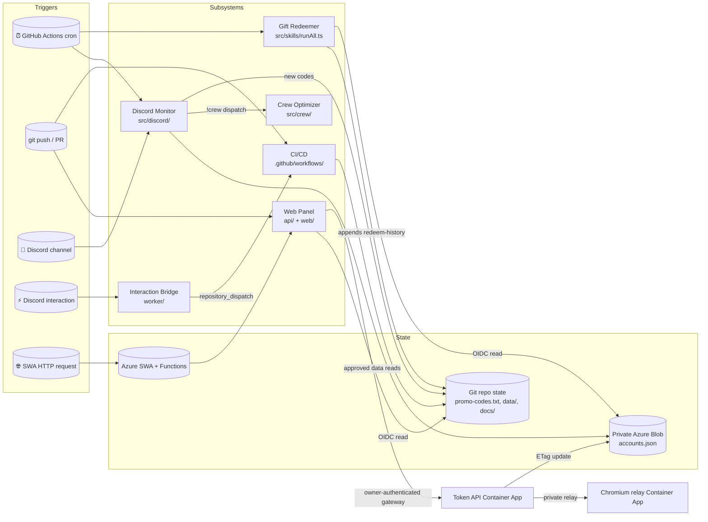
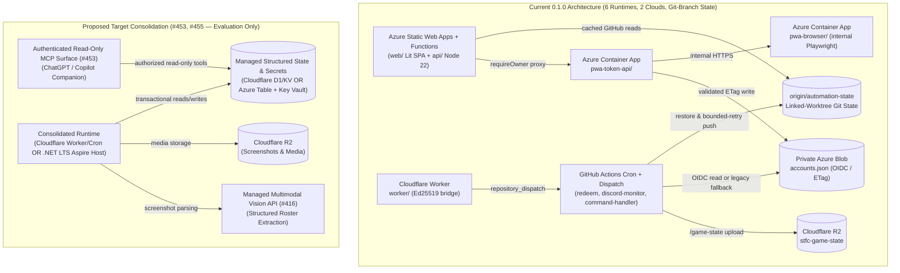
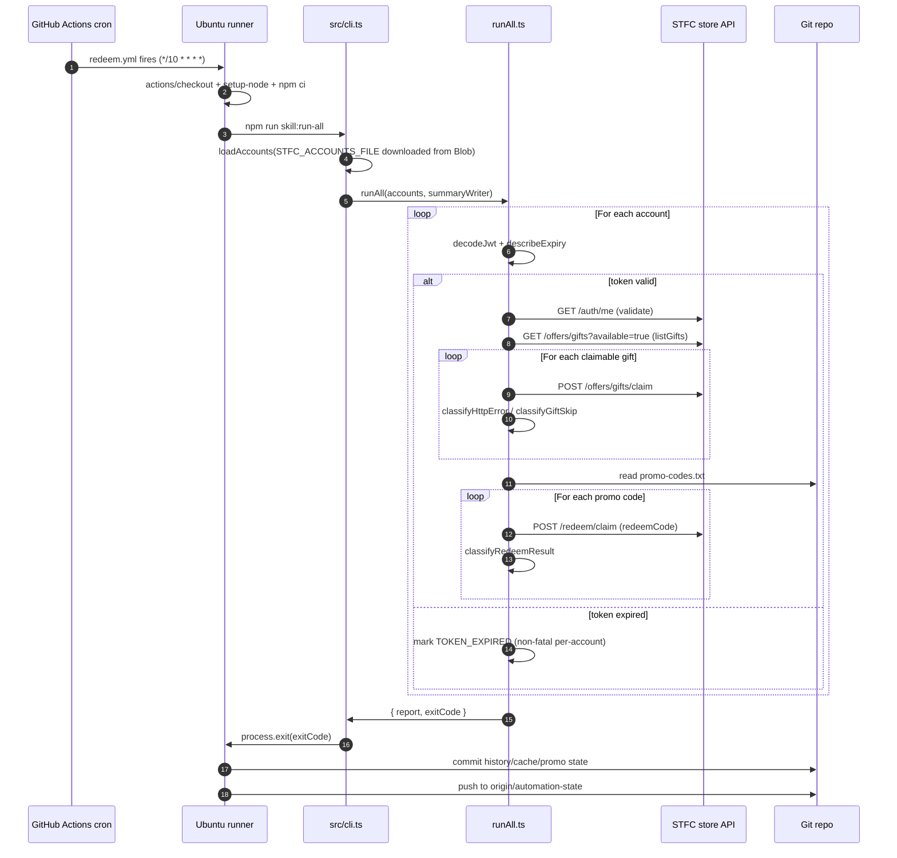
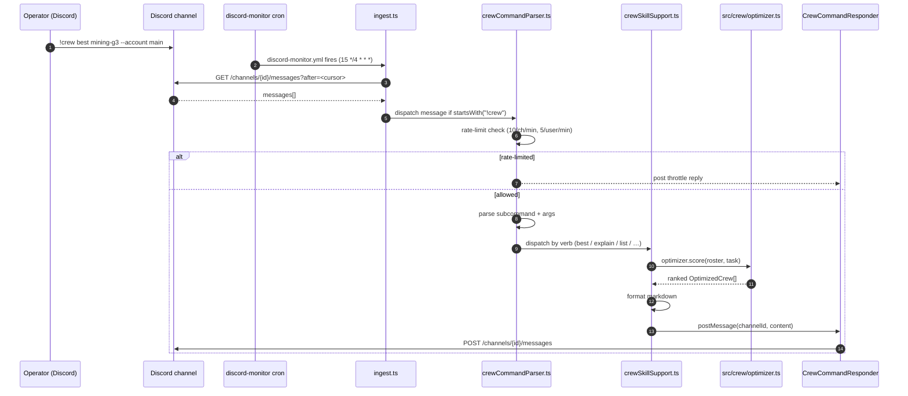
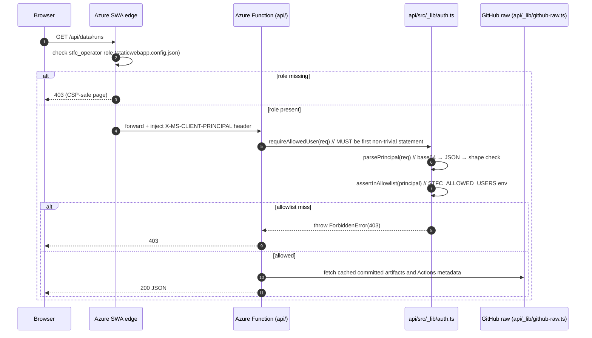

# System Architecture

> Single-source-of-truth overview of how the STFC product suite (`0.1.0` MVP
> six-subsystem baseline) works end-to-end. Reading order: top-down — start with
> repository origin and the topology map, drill into the subsystem you care
> about, and follow the cross-references for per-subsystem detail.

---

## 0. Repository origin & evolution

Created on **`2026-01-14`** for a mobile-first (iPhone) *Star Trek Fleet
Command* player to automate daily web-store gift claims and time-sensitive
community promo codes after an initial browser/iframe prototype hit
cross-origin isolation against Scopely's hosted web store.

From that initial workaround, the repository evolved through four phases into a
six-subsystem **`0.1.0` MVP** automation and companion platform:

1. **Phase 1 — Headless Web Store v2 CLI (`src/`):** Node 24 + TypeScript CLI
   talking directly to Scopely's Web Store v2 API with permissive Zod schemas,
   explicit `Outcome` classification, and truthful exit codes (`0` ok/partial,
   `1` infrastructure error, `2` all tokens rejected), scheduled via GitHub
   Actions (`redeem.yml`).
2. **Phase 2 — Private Token Lifecycle & Community Signal Ingestion (`pwa-token-api/`, `pwa-browser/`, `src/discord/`, `src/digest/`):**
   GitHub OIDC + private Azure Blob account-token storage (`STFC_ACCOUNTS_FILE`)
   with owner-only Container Apps browser/OTP token refresh (`pwa-token-api/`,
   `pwa-browser/`), paired with read-only Discord REST promo/tip ingestion
   (`src/discord/`, `src/digest/`) and runtime state isolated onto the orphan
   `automation-state` branch.
3. **Phase 3 — Offline Crew Intelligence & Discord Bridge (`src/crew/`, `worker/`):**
   Deterministic offline Crew Optimizer and local MiniLM embedding RAG engine
   (`src/crew/`), plus an Ed25519-verified Cloudflare Worker and private R2
   game-state capture bridge (`worker/`).
4. **Phase 4 — Operator Dashboard & Governed Delivery (`web/`, `api/`, `.squad/`):**
   Lit 3 + Vite Azure Static Web Apps operator dashboard and Azure Functions v4
   API (`web/`, `api/`) with two-layer operator/owner authentication,
   correlation-ID workflow telemetry, and governed multi-agent operations.

---

## 1. Topology at a glance



| Subsystem | Lives in | Triggered by | Owns |
|---|---|---|---|
| **Gift Redeemer** | `src/skills/runAll.ts`, `src/api/`, `src/lib/` | `redeem.yml` (`*/10 * * * *`) | STFC web-store API claims, exit-code semantics, `automation-state` history/cache updates |
| **Token Store & Browser Relay** | `pwa-token-api/`, `pwa-browser/` | Authenticated SWA gateway (`/api/token-session/*`) | ETag-conditioned Azure Blob `accounts.json` updates, live gift-endpoint validation, isolated Playwright login/OTP relay |
| **Discord Monitor** | `src/discord/`, `src/digest/` | `discord-monitor.yml` (`15 */4 * * *`) | Configured-channel ingest, promo codes, digests, `!crew` commands |
| **Crew Optimizer & RAG** | `src/crew/`, `src/skills/` | Local CLI and Discord monitor | Roster, optimization scoring, progression, local embedding RAG |
| **Discord Interaction Bridge** | `worker/`, `scripts/discord-handler.mjs`, `discord/` | Discord interactions → `repository_dispatch` | Signature verification, slash-command handling, R2 game-state uploads |
| **Web Control Panel** | `api/`, `web/`, `shared/contracts/` | Azure SWA HTTPS requests | Authenticated operator dashboard |
| **CI/CD** | `.github/workflows/`, `scripts/` | Git events, schedules, manual dispatch | Tests, typecheck, deploy, release, hygiene gates |

### 1.1 Runtime & cloud boundaries (current `0.1.0` vs. proposed consolidation)

The `0.1.0` baseline spans six runtime surfaces across GitHub Actions, Azure,
and Cloudflare, using the orphan `automation-state` Git branch as its mutable
operational store. Candidate simplification work tracked under `#453`
(read-only companion MCP server) and `#455` (hosting/CI/token-service TCO
consolidation) evaluates collapsing those boundaries into a single edge or
`.NET LTS` host with managed state — **proposed roadmap architecture only, not
an active or implied migration** until separately authorized:



| Boundary concern | Current `0.1.0` baseline | Proposed consolidation target (`#453`, `#455`) |
|---|---|---|
| **Compute runtimes** | GitHub Actions (Node 24), Azure Functions (Node 22), Lit/Vite SWA, 2 Container Apps (`pwa-token-api/`, `pwa-browser/`), Cloudflare Worker | Single primary compute plane (Cloudflare Workers/Cron **or** `.NET LTS` Aspire service) |
| **Operational state** | Orphan `automation-state` branch via detached worktrees + `queue: max` serialization | Managed database/KV (Cloudflare D1/KV or Azure Table Storage) without Git push races |
| **Account token storage** | Private Azure Blob (`STFC_ACCOUNTS_FILE` via OIDC; legacy secret recovery fallback) + 2 Container Apps for OTP capture | Secret Vault / KV with serverless browser rendering or guided local `recover-auth.ps1` |
| **Discord slash commands** | Worker Ed25519 verify → `repository_dispatch` → queued Actions runner | Direct sub-second execution in the edge/service host |
| **Operator companion UI** | Custom SWA Lit tabs (`web/`) reading committed artifacts | Read-only MCP server (`#453`) consumed directly from ChatGPT / GitHub Copilot + optional thin web view |

---

## 2. Repository layout

Only the meaningful top-level directories. Per-subsystem detail lives in §3.

```
.
├── src/                       # All TypeScript runtime code
│   ├── cli.ts                 # Single entrypoint (process.exit only here)
│   ├── api/                   # STFC web-store HTTP client + Zod schemas
│   ├── crew/                  # Crew optimizer domain (officers, roster, tasks)
│   ├── digest/                # Discord digest writers
│   ├── discord/               # Bot client, classifier, parser, state
│   ├── lib/                   # Cross-cutting helpers (accounts, jwt, logger, outcomes)
│   └── skills/                # Top-level "verbs" dispatched from cli.ts
│
├── api/                       # Azure Functions for the web control panel
│   ├── _lib/github-raw.ts     # GitHub data access
│   └── src/_lib/{auth,respond}.ts  # SWA principal auth + JSON response helpers
│
├── web/                       # Vite + Lit 3 SPA shell
│   ├── src/{app.ts,main.ts,components/}
│   ├── bundle-budget.json     # 81 920 B (80 KiB) gzipped JS budget
│   └── vite.config.ts
│
├── shared/contracts/          # AUTO-GENERATED TS types from JSON Schema
│                              # (run `npm run build:contracts`; drift-checked by `check:contracts`)
│
├── tests/                     # node:test suite (run via tsx)
├── scripts/
│   ├── pre-commit.mjs         # simple-git-hooks pre-commit (runs npm test)
│   ├── pre-push.mjs           # pre-push checks
│   └── ci/{check-api-auth,check-bundle-budget,check-contracts-types}.mjs
│
├── data/                      # Seeds on main; live runtime state on automation-state
│   ├── crew/                  # officers.json, roster/, tasks/, knowledge-embeddings.json
│   └── discord/               # Command channel template + game-state placeholder (cursors/digests live on automation-state)
│
├── pwa-token-api/             # Container App API writing ETag-conditioned tokens to private Azure Blob Storage
├── pwa-browser/               # Isolated headless Playwright Container App relay for STFC login/OTP capture
│
├── config/                    # Static config consumed by skills
│   ├── classifier-model.json
│   └── discord-allowlist.json
│
├── promo-codes.txt            # Human seed; operational union is on automation-state
├── docs/                      # User & operator docs (THIS file + per-subsystem)
├── specs/                     # Feature specs and contract references
├── .github/
│   ├── copilot-instructions.md # Repository-wide coding guidance
│   └── workflows/             # GitHub Actions workflows
├── discord/                   # Slash-command manifest (commands.json) + operator runbook
├── worker/                    # Cloudflare Worker for Discord interactions
├── staticwebapp.config.json   # SWA route + role + CSP config
└── package.json               # CLI scripts and root dependencies (`0.1.0` baseline)
```

---

## 3. Subsystem deep-dives

### 3.1 Gift Redeemer — `src/skills/runAll.ts`

The original product. Headless TS CLI that redeems STFC web-store gifts and
promo codes per account on a cron.

**Entrypoint.** Single `src/cli.ts` dispatcher — the ONLY file that calls
`process.exit`. Loads accounts, builds a summary writer, picks a skill by
`argv[2]`, and surfaces infra failures as exit code 1.

```
cli.ts → skills/runAll.ts → for each account: api/endpoints.ts → STFC store
                          → lib/outcomes.ts (classifies each result)
                          → lib/summary.ts (markdown summary for GH UI)
```

**Exit-code contract** (`src/skills/runAll.ts:891-899`):

| Code | Meaning |
|---|---|
| **0** | One or more accounts succeeded — or partial success per account. Per-account outcomes (`CODE_USED`, `ALREADY_CLAIMED`, etc.) do **not** fail the workflow. |
| **1** | Infrastructure error (malformed account-store data, schema mismatch, uncaught crash). `report.errors.length > 0`. |
| **2** | All accounts have `TOKEN_EXPIRED`. Refresh hosted tokens through the owner-only **STFC token update** PWA (`docs/STFC-TOKEN-PWA.md`), or re-capture local `.env` tokens with the local visible-browser flow. |

**Auth flow.** The private Azure Blob `accounts.json` contains the JSON array
of `{name, token}` records. Scheduled workflows use GitHub OIDC and a
read-only Blob identity, passing the downloaded file via `STFC_ACCOUNTS_FILE`
(the legacy `STFC_ACCOUNTS` GitHub secret is retained only for one-time Blob
migration via `refresh-token.yml` or unconfigured recovery fallback; local CLI
runs read `STFC_ACCOUNTS` from `.env`). The owner-only PWA writes through the authenticated
Functions gateway to a separate token API identity using ETag-conditioned
updates. Each `token` is a JWT against the Scopely store API. `src/lib/jwt.ts`
decodes + describes expiry; expired tokens become `TOKEN_EXPIRED` outcomes
(non-fatal per-account).

**Promo-code source.** Humans maintain `promo-codes.txt` on `main`; scheduled
jobs consume and persist its operational union on `automation-state`. Before
both redeem and Discord-monitor runs, `scripts/merge-promo-codes.mjs` starts
from the operational `automation-state` file, keys codes by the
comment-stripped `trim().toUpperCase()` token, collapses duplicate normalized
lines within each input, preserves the `automation-state` line on cross-input
duplicates, and appends only `main`-exclusive seed codes beneath
`# --- seeded from main@<sha> ---`. This contract is additive: deleting or
editing a code on `main` does not rewrite or delete the operational line. The
case-sensitive dead-cache lookup is a separate deferred concern.

**Idempotency.** Each promo code attempt is independent; outcomes
(`OK`, `CODE_USED`, `CODE_INVALID`, `RATE_LIMITED`, `TOKEN_EXPIRED`, etc.)
are classified by `src/lib/outcomes.ts`. Re-runs are safe.

**Scheduled by.** `.github/workflows/redeem.yml` — `*/10 * * * *` (every 10
min, 144 runs/day). It restores live history, dead-code cache, degraded-gift
streak state, and promo codes from `automation-state`, then commits changed
state there via `GITHUB_TOKEN`.
The protected `main` tip is never the automation push target.

**Ambiguous gift claims.** `data/redeem-degraded-state.json` stores per-account
(hashed account name) and bundle-ID transient streaks. After three consecutive
transient claim failures, the claim is deferred for 24 hours; one claim is
attempted on the first scheduled run at or after the deadline. Another
transient failure starts a new 24-hour delay. Successful and benign outcomes
clear the streak. Deferred claims remain `TRANSIENT` in the logs and step
summary, keeping the account degraded and the existing repeated-failure alert
open. State is migrated from versions 1 and 2 before claims proceed. Missing
state is initialized; unreadable or unwritable state is surfaced as an
infrastructure error and prevents gift claim POSTs rather than risking
untracked retries. Claim POSTs are never replayed within one run.

### 3.2 Discord Monitor — `src/discord/`

Read-only Discord bot that ingests promo codes from operator-curated
channels and routes `!crew` chat commands to the crew optimizer.

**Modules** (each file ≤ 430 LoC):

| File | Role |
|---|---|
| `client.ts` | Low-level Discord REST client (auth, rate-limit retry, errors) |
| `ingest.ts` | Per-channel pager — pages `/channels/{id}/messages?after=<cursor>` ≤ 5 pages/run, advances cursor in memory, orchestrator flushes |
| `classifier.ts` | Heuristic + keyword classifier — promo code vs noise |
| `extractor.ts` | Pulls the literal code substring from a matched message |
| `dedup.ts` | Hash-based dedup against `data/discord/` state |
| `moderation.ts` | Stoplist + suspicious-pattern filter |
| `stoplist.ts` | Operator-managed deny list |
| `state.ts` | Per-channel cursor + cooldown persistence |
| `schemas.ts` | Zod schemas (DiscordMessage, RunHealth, IngestionCursorMap, …) |
| `cooldown.ts` | Channel/user rolling-window rate limit |
| `crewCommandParser.ts` | `!crew` command parser + dispatch (see below) |

**Ingest contract.** `specs/003-discord-oauth/data-model.md` is the
authoritative source. On error:

- **401** → re-throw `DiscordAuthError` (orchestrator records `auth_failed`,
  redeemer still runs).
- **403/404** → channel marked errored, others continue, remediation string
  surfaced in `RunHealth.channelsErrored[]`.
- **429** → bounded retry in client (≤ 3×), else channel-errored.
- **5xx** → `DiscordTransientError`, one retry already taken in client.

**`!crew` message commands** (`src/discord/crewCommandParser.ts`):

- Prefix: `!crew`
- Rate limit: **10/min per channel, 5/min per user** (`CHANNEL_LIMIT` /
  `USER_LIMIT` constants; rolling 60-second window via `pruneWindow`).
- Allowlist class + rate-limit class + parser are unit-testable in
  isolation.
- Read-only crew queries are routed to the crew skills; see §3.3 and
  `docs/CREW-OPTIMIZER.md`.

**Secret.** `DISCORD_BOT_TOKEN` is a GitHub Actions secret, **CI-only**.
Codespaces cannot read it (the Codespaces-injected `GITHUB_TOKEN` lacks
repository-secret read scope). Local development uses fixtures + mocked
HTTP — never the real bot token.

**Scheduled by.** `discord-monitor.yml` — `15 */4 * * *` (15 min past every
4th hour). Staggered from the redeemer's `*/10` cadence to avoid the
shared concurrency group `stfc-gift-redeemer` blocking. The shared group
serializes scheduled workflows that write `promo-codes.txt`, `data/`, or
`docs/redeem-history.md` on `automation-state`.

### 3.3 Crew Optimizer — `src/crew/`

In-game crew assembly optimizer. Computes the highest-scoring 3-officer
crew (captain + 2 bridge + below-deck) for a given task definition, given
a roster.

**Domain model:**

| Concept | File | Notes |
|---|---|---|
| Officers | `data/crew/officers.json` (loaded by `database.ts`) | Master officer list with tags, factions, abilities |
| Roster | `data/crew/roster/` (per-account) | Owned officers + levels |
| Tasks | `data/crew/tasks/` | Task definitions: tag weights, synergy bonus, slot constraints |
| Optimizer | `src/crew/optimizer.ts` (325 LoC) | Scoring + slot allocation |
| Progression | `src/crew/progression.ts` | Level-up planning |
| Staleness | `src/crew/staleness.ts` | Detects when roster needs re-export |
| Diff | `src/crew/diff.ts` | Roster delta reporting |

**Authoritative spec.** `specs/004-crew-optimizer/` (`spec.md`,
`plan.md`, `data-model.md`, `tasks.md`).

**`!crew` Discord handlers.** Read-only message commands route through
`src/discord/crewCommandParser.ts` and `src/skills/crewSkillSupport.ts`.

**Knowledge retrieval** uses the committed `data/crew/knowledge-embeddings.json`
artifact, rebuilt by `knowledge-rebuild.yml` when its source files change.

**Per-account outputs.** Run the optimizer or progression CLI locally to
generate reports under `docs/crew/`; no workflow regenerates these reports.

**Detailed runbook.** `docs/CREW-OPTIMIZER.md`.

### 3.4 Web Control Panel — `api/` + `web/` + `shared/contracts/`

The operator dashboard is an authenticated Lit + Vite SPA backed by
Azure Static Web Apps + Functions.

**Topology:**

```
Browser → Azure SWA edge → /api/* → Linked Azure Function (api/)
                       → /*    → Static asset (web/dist/)
```

**Two-gate authentication** — defence-in-depth model
(`api/src/_lib/auth.ts:1-12`):

1. **SWA edge gate** — `staticwebapp.config.json` requires the
   `stfc_operator` role on every protected route. Edge rejects with the
   CSP-safe 403 page if absent.
2. **Function-side allowlist re-check** — every handler MUST call
   `requireAllowedUser(req)` or `requireOwner(req)` as its first
   non-trivial statement. The principal is decoded from the
   `X-MS-CLIENT-PRINCIPAL` base64 JSON header
   (`api/src/_lib/auth.ts:62-77`), validated for shape, and checked
   against the `STFC_ALLOWED_USERS` env var (comma-separated GitHub
   logins).

   - `requireOwner` re-validates against the allowlist even when given a
     pre-parsed Principal (`auth.ts:115-138`), preventing a synthetic
     principal from bypassing the gate.
   - `requireRole(req, role)` is deliberately **not** accepted by the
     grep gate — forces username allowlist or owner re-check.

**CI gate.** `scripts/ci/check-api-auth.mjs` walks `api/src/**.ts`
(excluding `_lib`, `dist`, `node_modules`) and asserts every HTTP handler
calls `requireAllowedUser`/`requireOwner` as its first non-trivial
statement. Opt-out via
`// @auth-anonymous-justification: <reason>`.

**Frontend.** `web/src/app.ts` is the Lit 3 root that hash-routes between
the dashboard sections; each section is implemented as a custom element.

**STFC token update PWA.** The owner-only tab opens a short-lived sign-in
session in a separate self-hosted Chromium relay. The relay has no Blob
identity; the token API validates the captured token against the
non-destructive `/offers/gifts?available=true` endpoint used by redemption,
then updates the private account Blob conditionally. OTPs and tokens are never
returned to the PWA or persisted in browser storage. The relay must use
internal Container Apps ingress; only the token API may call it.

**Bundle budget.** 81 920 bytes (= 80 KiB) gzipped JS,
enforced by `scripts/ci/check-bundle-budget.mjs`. The checker excludes
`rag-index.json`.

**Shared contracts.** TypeScript types + Zod schemas auto-generated from
JSON Schema sources via `npm run build:contracts`; drift detected via
`npm run check:contracts`. Three contracts ship today
(`shared/contracts/`): `audit-event.ts`, `chat-tool-call.ts`,
`run-result.ts`. Auto-generated — **do not hand-edit**. Both root
`tsconfig.json` and `api/tsconfig.json` carry the `@stfc/contracts/*`
path alias; either consumer can break independently — verify both when
adding a contract.

**Deploy.** `.github/workflows/swa-deploy.yml`:
- Prod on push to `main`.
- Preview on PR open/sync/reopen targeting `main`.
- Teardown on PR close.
- Auth: `AZURE_STATIC_WEB_APPS_API_TOKEN` repository secret, required by the
  pinned official Azure deploy action. Skips gracefully when it is unset.

**Operator runbooks.**
- Setup: `docs/SWA-SETUP.md`

The API source currently has helpers in both `api/_lib/` and
`api/src/_lib/`; account for both paths when navigating the function code.

### 3.5 CI/CD — `.github/workflows/` + `scripts/`

The repository has several focused workflows. Selected examples:

| Workflow | Purpose | Trigger |
|---|---|---|
| `redeem.yml` | Gift redemption and state persistence | `*/10 * * * *` + manual dispatch |
| `discord-monitor.yml` | Configured-channel ingest, code discovery, and digest | `15 */4 * * *` + manual dispatch |
| `refresh-token.yml` | One-time migration of the legacy account secret to Blob | Manual dispatch only; no schedule |
| `discord-command-handler.yml` | Handle Discord slash-command dispatches | `repository_dispatch` |
| `deploy-cloudflare-worker.yml` | Deploy the Discord interaction bridge | Worker changes + manual dispatch |
| `knowledge-rebuild.yml` | Rebuild crew knowledge embeddings | Watched source changes + manual dispatch |
| `swa-deploy.yml` | Azure Static Web Apps deploy and PR previews | `main` pushes and pull requests |
| `test-gate.yml` | Root and Worker tests + typechecks (plus `pwa-browser` and `pwa-token-api` typechecks) | Pull requests |

Other automation and maintenance workflows live under
`.github/workflows/`; consult their triggers and conditions before relying on
them. In particular, `refresh-token.yml` no longer performs a provider login
or refresh; token updates happen in the owner-only PWA.

**Pre-commit.** `scripts/pre-commit.mjs` (installed by `simple-git-hooks`):

1. Runs `check-artifact-hygiene.mjs --staged` on staged content.
2. Parses staged changes via `git diff --cached --name-status -z -M -C`
   (`parseNameStatus` in `scripts/pre-commit-checks.mjs`). `-z` emits
   NUL-delimited records so filenames with spaces, unicode, or characters
   Git would otherwise quote parse safely; `-M -C` enable explicit
   rename/copy detection rather than relying on the repo's `diff.renames`
   config. Renames/copies emit `<status>\0<old>\0<new>\0`; every other
   status emits `<status>\0<path>\0`. The parser derives `staged` (every
   touched path, including deletions and rename/copy destinations — this
   matches the old `--name-only` behavior other checks depend on),
   `deleted` (paths removed outright), and `renamedFrom` (rename/copy source
   paths).
3. Runs `checkPortableFilenames` — blocks filenames illegal on Windows.
4. Runs `checkWorkflowPinningTests` when workflow files are staged.
5. Runs `npm test` via `node:test` + `tsx`.

**Bypass.** Prefer fixing failing checks rather than bypassing hooks.

**Test discipline.** `npm test` + `npm run typecheck` are the gates.
Validate at `package.json:20,28`.

**Other CI gates** invoked from workflows (not pre-commit):

- `scripts/ci/check-api-auth.mjs` — Function-handler first-statement auth.
- `scripts/ci/check-bundle-budget.mjs` — 80 KiB gzipped JS cap.
- `scripts/ci/check-contracts-types.mjs` — generated TS vs JSON Schema
  drift.
- `scripts/check-artifact-hygiene.mjs` — secret / token redaction,
  also invoked by `artifact-hygiene.yml` and the pre-commit hook.

**Pinning tests.** `tests/skills/discordMonitor.test.ts`,
`tests/workflows/*.test.ts` pin workflow values literally (crons,
`concurrency.group`, permission scopes). Any edit to the workflow
ships in the same commit as the pinning-test update (enforced locally by
`checkWorkflowPinningTests` in `scripts/pre-commit-checks.mjs`).
Canonical pattern is **structural parse + assert on object graph**, not
substring grep.

**Deploy auth.** Static Web Apps deployment token. The official pinned deploy
action requires this input; workflow skips gracefully when
`AZURE_STATIC_WEB_APPS_API_TOKEN` is unset.

---

## 4. Data flows

### 4.1 Scheduled gift redemption



Exit code semantics: 0 / 1 / 2 per `runAll.ts:891-899` (see §3.1).

### 4.2 `!crew` Discord command dispatch



Detailed verb list + handler routing: `specs/004-crew-optimizer/`.

### 4.3 Web Panel — authenticated read



All five tabs use the read-only `data/{tab}` Function. Redeem history and digests
read `automation-state`; officer reference data and optional run-result artifacts
read `main`. Runs merge cached Actions metadata with validated v1 run results by
correlation ID. Unknown or invalid artifacts fail rather than disappearing.
The telemetry endpoint reports explicitly unavailable because no approved
telemetry artifact producer exists; it does not invent metrics.

---

## 5. Cross-cutting concerns

### 5.1 Secret management

- **Hosted account tokens** live in private Azure Blob Storage (`accounts.json`)
  and are read by scheduled workflows through GitHub OIDC (`STFC_ACCOUNTS_FILE`),
  never long-lived GitHub secrets.
- **CI secrets** (`DISCORD_BOT_TOKEN`, legacy `STFC_ACCOUNTS` during one-time migration,
  `AZURE_STATIC_WEB_APPS_API_TOKEN`): set via
  `gh secret set <NAME> --repo Jamula/stfc` from a **LOCAL terminal
  only**. `gh` prompts with hidden input.
- **Codespaces token scopes.** The Codespaces-injected `GITHUB_TOKEN`
  lacks `security_events` (and other) scopes, so calls like
  `gh api repos/{owner}/{repo}/code-scanning/alerts` 403 from inside a
  Codespace. This is a **token-scope** issue, NOT an Advanced Security
  one — diagnose by checking `gh auth status | grep -i scope`.
- **Never paste secrets in chat.** Any credential pasted into a session
  transcript must be treated as compromised and rotated immediately, as
  transcripts persist in the session store.

### 5.2 Automation-state lifecycle

Live automation data is intentionally split from reviewed source:

| Store | Purpose |
|---|---|
| `main:promo-codes.txt` | Human seed and comment/casing authority |
| `automation-state:promo-codes.txt` | Canonical operational additive list |
| Runner working tree | Deterministic merged input for one run |

The state allowlist is `docs/redeem-history.md`,
`data/promo-code-dead.json`, `data/redeem-degraded-state.json`, `promo-codes.txt`, `data/discord`, and
`data/digests`. Missing optional outputs preserve the branch's existing copy,
and each path is staged separately so one missing path cannot suppress another.
`discord-command-handler.yml` runs the current main-branch handler script with
a linked `automation-state` worktree as its working repository:
`/redeem-status` reads current history and `/game-state` reads/writes current
game-state. `storage-size-monitor.yml` checks out that live ref directly.

**Writer serialization.**
`redeem.yml`, `discord-monitor.yml` and the one-time `refresh-token.yml` share one
`stfc-gift-redeemer` concurrency group (`cancel-in-progress: false`) so their
pushes to `automation-state` never interleave.
`discord-command-handler.yml`'s concurrency group is
command-dependent: `/game-state` — the only Discord command that uploads game
state to Cloudflare R2 and commits the small `manifest.json`, `.lineage.json`,
and `_index.json` metadata to `automation-state` directly
(`scripts/discord-handler.mjs`) — joins that same `stfc-gift-redeemer` lock,
because the exact interleaving that let a monitor run silently delete a handler
upload (fetch the tip *after* a handler push landed, then fast-forward a
wholesale replace of `data/discord` — a non-conflicting commit the push-retry
loop never notices) applies to it too.
`/redeem-status` (read-only) and `/trigger-redeem` (only dispatches
`redeem.yml`, itself already serialized) never touch git directly, so each
gets an isolated per-command group instead of queuing behind scheduled runs —
proven both by a workflow-level pin of the exact concurrency expression
(`tests/workflows/automation-state-workflows.test.ts`) and by asserting zero
`git` calls for those two commands (`tests/scripts/discordHandler.test.ts`).

**Queue semantics and the overflow contract.** Sharing a group is necessary
but not sufficient. A concurrency group's default `queue: single` holds **at
most one pending run**: whenever a newer run of *any* workflow in the group
arrives, the pending one is cancelled and replaced. With `redeem.yml` on a
`*/10` cron that would routinely evict a pending `/game-state` job *before it
ever executed* — the Worker has already returned Discord's deferred response,
so the upload is lost with no follow-up, trading a post-push deletion race for
pre-execution upload loss. Every workflow that can join `stfc-gift-redeemer`
therefore declares `queue: max`:

- **Bound:** up to **100** runs may sit `pending` in the group, released in
  first-in-first-out order by the time each started waiting on the group (not
  the time it was dispatched); GitHub notes exact ordering is not guaranteed
  when actual start times vary.
- **No silent replacement within the bound.** Below 100 pending runs, a newer
  run never cancels an older pending one — the loss mode above is gone.
- **Overflow is visible, not silent.** The 101st pending run is *cancelled by
  Actions* and shows up as a cancelled run in the Actions UI/API. It is not
  retried automatically: an operator must re-dispatch it (re-run the workflow,
  or re-issue the Discord command). This is a loss-bounded queue, not an
  infinite or durable one — nothing here persists a run across that limit.
- **`queue: max` cannot be combined with `cancel-in-progress: true`** (GitHub
  rejects that combination as a workflow validation error), so shared writers
  keep `cancel-in-progress: false`.
- **Case-insensitivity.** GitHub compares both concurrency group names and the
  `==` operator case-insensitively, so a `GAME-STATE` payload resolves to the
  shared writer group and *over*-serializes. `scripts/discord-handler.mjs`
  dispatches on exact lower-case strings, so such a payload answers "Unknown
  command" without touching git — safe in the conservative direction.

`tests/workflows/automation-state-workflows.test.ts` enumerates every parsed
`concurrency:` block under `.github/workflows/` and fails if any workflow that
can resolve to `stfc-gift-redeemer` omits `queue: max`, leaves the default
`single`, or pairs `queue: max` with `cancel-in-progress: true`.

**Game-state storage.** For new captures, `/game-state` stores the binary attachment in the
Cloudflare R2 bucket `stfc-game-state` (or `STFC_GAME_STATE_R2_BUCKET`) using R2's auto-region S3-compatible
endpoint. The handler commits only small, diff-friendly metadata for new uploads under each
daily `data/discord/game-state/YYYY-MM-DD/` folder:

- `manifest.json` — R2 bucket/key, SHA-256, size, content type, signed-access
  requirement, and retention (`forever` for the current implementation).
- `<filename>.lineage.json` — Discord source, uploader, note, capture time, and
  the same R2 integrity fields.
- `_index.json` — the daily query index used for lightweight browsing.

Existing binaries already stored in git are not migrated or removed by this
slice; historical migration remains deferred under #164.

Game-state blobs are not staged into git after the R2 upload succeeds. Access is
recorded as `signed-url-required`; if R2 spend becomes undesirable, the existing
LFS fallback remains a Plan B rather than the active path.

Each daily manifest declares the effective bucket, and every entry must match
that bucket. Changing buckets within a day fails before download/upload or
metadata writes; existing objects are never relabeled. Keep that day's bucket
or explicitly migrate its objects and metadata before switching. A missing
legacy bucket field is inferred only from consistent entry locations. The
handler supports manifest version 1; a missing legacy version is treated as
version 1, while any explicit unsupported version is rejected before download,
upload, or metadata writes. Unknown fields on supported version 1 manifests are
preserved when a capture is appended.

After a failed git push, the handler fetches the remote state and checks whether
it contains the attempted commit. A lost acknowledgement of a published commit
counts as success. Confirmed unpublished uploads may be rolled back; if remote
publication cannot be determined, the object is preserved and the handler
reports its bucket/key and fails loudly for operator reconciliation. A PUT
timeout, network failure, or server error is also an uncertain outcome: its
failure follow-up includes the possible object's bucket/key, and operators
must inspect that location before retrying or deleting anything. Other PUT
errors also include the bucket/key for diagnosis.

`discord-monitor.yml` additionally never stages `data/discord/game-state`
(`scripts/discord-monitor-state.mjs` copies only its own allowlisted files),
which is defense in depth on top of the shared lock, not a substitute for it —
`tests/workflows/automation-state-race.test.ts` exercises the exact git-level
interleaving against real plumbing to prove the ownership exclusion holds even
if serialization were somehow bypassed, and regresses the pre-fix
wholesale-replace pattern to show it actually loses data under that same
interleaving. That suite runs its git plumbing asynchronously and keeps every
scratch directory under `os.tmpdir()`, so it neither blocks the shared
`node:test` event loop nor leaves untracked directories in the working tree.

On first use, a writer adds a detached **linked worktree** from the authenticated
Actions checkout, switches it to orphan branch `automation-state`, clears the
inherited index, and copies only allowlisted state. This preserves
`actions/checkout` credentials without a PAT, deploy key, bypass actor,
standalone `git init`, or remote reconfiguration. Existing state uses
`git worktree add -B` from `origin/automation-state`. Restore publishes a
success output; `if: always()` persistence is gated on it and cannot overwrite
live state after an incomplete restore.

Operational rollback is forward-only: revert a bad state commit with
`git revert`, never reset or force-push. To reset the dead cache, commit removal
of `data/promo-code-dead.json` on `automation-state`; deleting the frozen
`main` copy has no effect. To roll back the architecture, first copy live
allowlisted data back through a reviewed `main` PR, then revert this workflow
change. Review the current repository ruleset and run history before making
operational assumptions; their state is not represented by this source tree.

### 5.3 Operating constraints

- **Codespaces idle timeout.** Default 30 min — kills long fleets. Bump
  via `gh codespace edit -c "$CODESPACE_NAME" --idle-timeout 240m`
  (per-session) or set the user-default at
  https://github.com/settings/codespaces. Do **not** install
  `systemd`/`tmux`/cron-keepalive — the runtime is the authority.
- **Automation state diverges from main by design.** Scheduled state commits
  land on `origin/automation-state`; source changes continue through reviewed
  pull requests to `main`.
- **CodeQL scan lag** can reject a push briefly even when the previous
  commit was green. Wait 30-60 s and retry. Never
  amend or `--no-verify` interactive source commits.

### 5.4 Testing & quality gates

- **Unit tests** via `node:test` + `tsx` (`npm test`). The single entrypoint
  `tests/index.test.ts` aggregates the root suite.
- **Typecheck** via `npm run typecheck` (TypeScript 7; strict mode).
- **Pre-commit hook** runs the full suite on every commit
  (`scripts/pre-commit.mjs`). Prefer fixing failing tests locally rather than
  bypassing hooks (`--no-verify` is reserved for automated workflow state
  commits on CI runners; see `.github/copilot-instructions.md`).
- **CI checks:** `test-gate.yml` ("npm test (required)") and GitHub
  CodeQL default setup ("Analyze (javascript-typescript)"). Repository
  rules determine whether these checks are required.
- **CodeQL:** one canonical GitHub default-setup workflow analyzes Actions
  workflow files and JavaScript/TypeScript. The two `Analyze (...)` jobs are
  language jobs within that workflow, not duplicate workflows.
- **Coverage:** GitHub Actions coverage upload is intentionally disconnected.
  No repository workflow invokes `test:coverage` or
  `actions/upload-code-coverage`; restoring both is the deliberate re-enable
  path.
- **Bundle budget:** 80 KiB gzipped JS for `web/dist/`
  (`scripts/ci/check-bundle-budget.mjs`).
- **Artifact hygiene:** `artifact-hygiene.yml` scans PR diffs for
  JWTs, API keys, account data; redacts to `<REDACTED-TOKEN>` in any
  output.
- **Contract drift:** `npm run check:contracts` against
  `shared/contracts/*.ts`.
- **API auth gate:** `scripts/ci/check-api-auth.mjs` (first-statement
  enforcement).

---

### 5.5 Product version and release publishing

Product versioning is governed by [`docs/VERSIONING.md`](VERSIONING.md).
The root `package.json` and root lockfile declare the `0.1.0` product
baseline; subpackage versions and `.nvmrc` describe separate components
and toolchains. Changes are tracked in `CHANGELOG.md` under `[Unreleased]`
until MVP acceptance and a separate owner-approved release decision.

The `.github/workflows/release.yml` pipeline is **manual dispatch only**:
reviewed `main` plus an exact approved version input, independent build/tests,
root metadata/lockfile/changelog validation, and a `v<version>` tag and GitHub
Release only if that tag does not already exist. The workflow does not approve
its own invocation, and any release or production deployment remains a
separately authorized action. Historical `v1.0.0` predates the agreed
`v0.1.0` product baseline and is preserved, not silently reinterpreted.

---

## 6. Reference index

| Look up | Where |
|---|---|
| How does subsystem X work? | §3.X |
| Current vs. proposed consolidated runtime boundaries | §1.1 |
| Discord `!crew` command end-to-end flow | §4.2 |
| Scheduled gift redemption flow | §4.1 + `redeem.yml` |
| Web panel request auth flow | §4.3 + `api/src/_lib/auth.ts` |
| Exit-code semantics | §3.1 + `src/skills/runAll.ts:399-407` |
| Feature specifications | `specs/NNN-feature-slug/` |
| Repository rules | `.github/copilot-instructions.md` |
| Web panel setup | `docs/SWA-SETUP.md` |
| Web panel invitation and setup | `docs/SWA-SETUP.md` |
| Crew optimizer details | `docs/CREW-OPTIMIZER.md` |
| Discord bot setup | `docs/DISCORD-BOT-SETUP.md` |
| Initial env setup | `docs/SETUP.md` |
| STFC game terminology (canonical) | `docs/stfc-game-knowledge.md` |
| Discord-sourced game knowledge | `docs/stfc-knowledge/` |
| Private token store & browser relay | `docs/STFC-TOKEN-PWA.md` |
| Discord slash-command bridge | `discord/RUNBOOK.md` |

---

## 7. Operational verification limits

Repository files describe intended workflows and application behavior, not
whether external services are currently provisioned or reachable. Before
operating the Azure deployment, Discord bot, or Cloudflare storage, check the
latest workflow runs and the service configuration in its owning console.
Never infer that a workflow ran successfully from its presence in this tree.

---

## 8. How to make changes safely

1. Describe non-trivial work in an issue or pull request and use an isolated
   branch or worktree.
2. Add regression tests for changes in behavior. For bug fixes, record the
   failing-before and passing-after evidence requested by the PR template.
3. Update workflow pinning tests when changing `.github/workflows/*.yml`;
   prefer structural YAML assertions.
4. Run `npm test` and `npm run typecheck` independently, plus the relevant
   sub-package checks. The pre-commit hook runs the root tests.
5. Complete the pull request template and request review. Passing checks and
   approval do not authorize a merge, auto-merge, or marking a PR ready without
   an explicit user request.

---

*Prefer cross-references over duplication — when a
subsystem's behaviour changes, update its own doc and adjust the
**pointer** here, not the body.*
