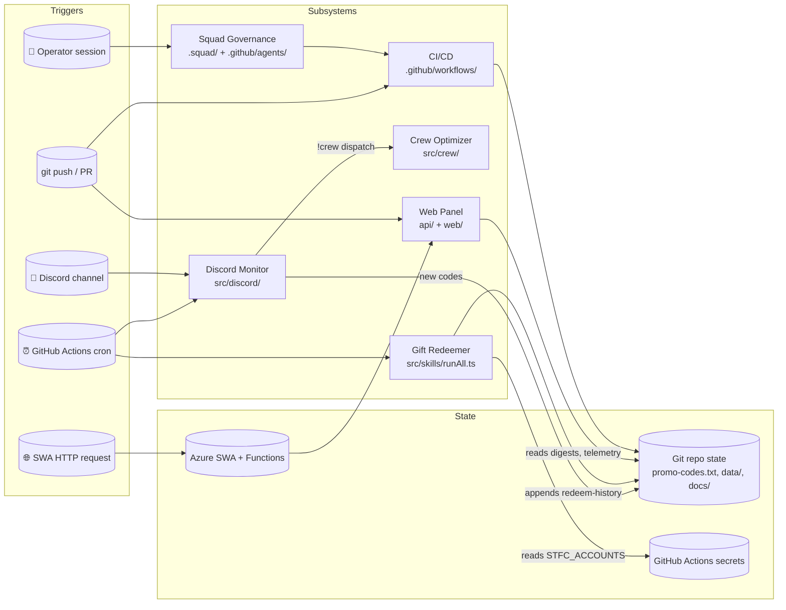
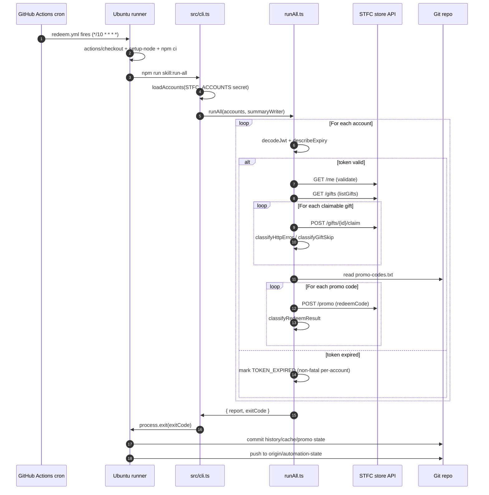
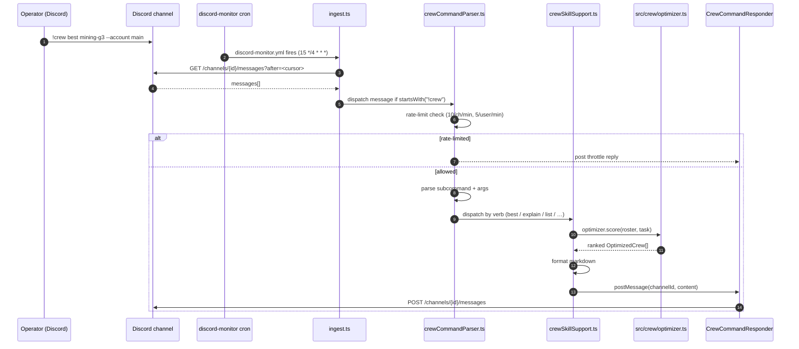
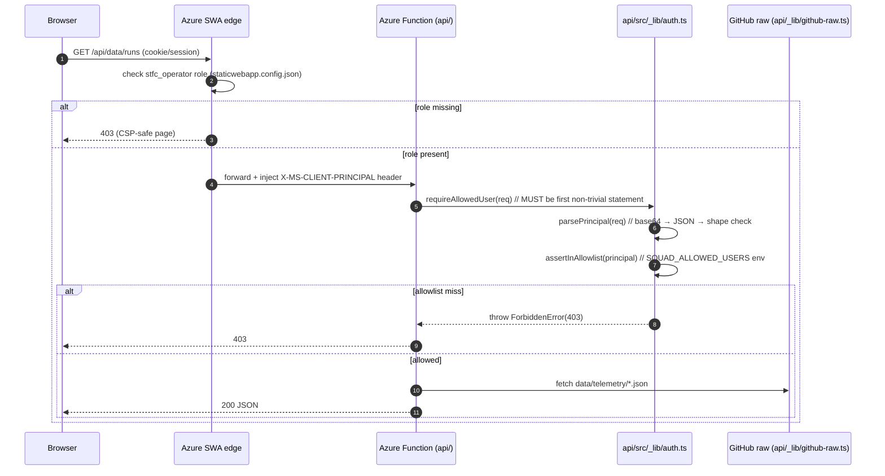

# System Architecture

> Single-source-of-truth overview of how the STFC product suite works
> end-to-end. Reading order: top-down — start with the topology map,
> drill into the subsystem you care about, follow the cross-references
> for per-subsystem detail. Last refreshed 2026-06-01.

---

## 1. Topology at a glance



| Subsystem | Lives in | Triggered by | Owns |
|---|---|---|---|
| **Gift Redeemer** | `src/skills/runAll.ts`, `src/api/`, `src/lib/` | `redeem.yml` (`*/10 * * * *`) | STFC web-store API claims, exit-code semantics |
| **Discord Monitor** | `src/discord/` | `discord-monitor.yml` (`15 */4 * * *`) | Promo code ingest, `!crew` command parser, dedup/cooldown state |
| **Crew Optimizer** | `src/crew/`, `src/skills/optimizeCrew.ts` | `optimize-crew.yml` (push to `data/crew/**`), `!crew` commands | Roster, optimization scoring, progression, task synergies |
| **Web Control Panel** | `api/`, `web/`, `shared/contracts/` | Azure SWA HTTPS requests | Read-only operator dashboard (Phase 1) |
| **Squad Governance** | `.squad/`, `.github/agents/` | Coordinator session start | Agent dispatch, decisions ledger, agent memory |
| **CI/CD** | `.github/workflows/`, `scripts/` | git events + cron | Tests, typecheck, lint, deploy, hygiene gates |

---

## 2. Repository layout

Only the meaningful top-level directories. Per-subsystem detail lives in §3.

```
.
├── src/                       # All TypeScript runtime code
│   ├── cli.ts                 # Single entrypoint (process.exit only here)
│   ├── api/                   # STFC web-store HTTP client + Zod schemas
│   ├── crew/                  # Crew optimizer domain (officers, roster, tasks)
│   ├── digest/                # Discord digest writers
│   ├── discord/               # Bot client, classifier, parser, state
│   ├── lib/                   # Cross-cutting helpers (accounts, jwt, logger, outcomes)
│   ├── skills/                # Top-level "verbs" dispatched from cli.ts
│   └── telemetry/             # Run-result emitter
│
├── api/                       # Azure Functions (Wave 3 Phase 1 web panel)
│   ├── _lib/github-raw.ts     # ⚠️ Layout inconsistency w/ src/_lib (PR #124 finding)
│   └── src/_lib/{auth,respond}.ts  # SWA principal auth + JSON response helpers
│
├── web/                       # Vite + Lit 3 SPA shell
│   ├── src/{app.ts,main.ts,components/}
│   ├── bundle-budget.json     # 81 920 B (80 KiB) gzipped JS budget
│   └── vite.config.ts
│
├── shared/contracts/          # AUTO-GENERATED TS types from JSON Schema
│                              # (run `npm run build:contracts`; drift-checked by `check:contracts`)
│
├── tests/                     # 900+ node:test specs (run via tsx)
├── scripts/
│   ├── pre-commit.mjs         # simple-git-hooks pre-commit (runs npm test)
│   ├── pre-push.mjs           # pre-push checks
│   └── ci/{check-api-auth,check-bundle-budget,check-contracts-types}.mjs
│
├── data/                      # Seeds on main; selected live state on automation-state
│   ├── crew/                  # officers.json, roster/, tasks/ (crew domain)
│   ├── digests/               # Discord digest snapshots
│   ├── discord/               # Cursor + cooldown state
│   └── telemetry/             # Run-result history
│
├── config/                    # Static config consumed by skills
│   ├── classifier-model.json
│   ├── discord-allowlist.json
│   └── model-tiers.json
│
├── promo-codes.txt            # Human seed; operational union is on automation-state
├── docs/                      # User & operator docs (THIS file + per-subsystem)
├── specs/                     # Feature specs and contract references
├── .squad/                    # Squad governance state (agent histories, decisions, etc.)
├── .copilot/skills/           # 11 coordinator-level skills (SKILL.md packages)
├── .github/
│   ├── agents/squad.agent.md  # Coordinator (1 140 LoC, modular post-cleanup PR1)
│   ├── copilot-instructions.md # 22 repo-wide rules (global, ALL agents)
│   └── workflows/             # 14 GitHub Actions workflows
└── staticwebapp.config.json   # SWA route + role + CSP config
```

---

## 3. Subsystem deep-dives

### 3.1 Gift Redeemer — `src/skills/runAll.ts`

The original product. Headless TS CLI that redeems STFC web-store gifts and
promo codes per account on a cron.

**Entrypoint.** Single `src/cli.ts` dispatcher — the ONLY file that calls
`process.exit`. Loads accounts, builds a summary writer, picks a skill by
`argv[2]`, and surfaces infra failures as exit code 1.

```
cli.ts → skills/runAll.ts → for each account: api/endpoints.ts → STFC store
                          → lib/outcomes.ts (classifies each result)
                          → lib/summary.ts (markdown summary for GH UI)
```

**Exit-code contract** (`src/skills/runAll.ts:399-407`):

| Code | Meaning |
|---|---|
| **0** | One or more accounts succeeded — or partial success per account. Per-account outcomes (`CODE_USED`, `ALREADY_CLAIMED`, etc.) do **not** fail the workflow. |
| **1** | Infrastructure error (malformed `STFC_ACCOUNTS`, schema mismatch, uncaught crash). `report.errors.length > 0`. |
| **2** | All accounts have `TOKEN_EXPIRED`. Cron fires this when every JWT is stale, prompting a manual or scheduled `refresh-token.yml` run. |

**Auth flow.** `STFC_ACCOUNTS` repo secret = JSON array of `{name, token}`.
Each `token` is a JWT against the Scopely store API. `src/lib/jwt.ts`
decodes + describes expiry; expired tokens become `TOKEN_EXPIRED` outcomes
(non-fatal per-account).

**Promo-code source.** Humans maintain `promo-codes.txt` on `main`; scheduled
jobs consume and persist its operational union on `automation-state`. Before
both redeem and Discord-monitor runs, `scripts/merge-promo-codes.mjs` starts
from the operational `automation-state` file, keys codes by the
comment-stripped `trim().toUpperCase()` token, collapses duplicate normalized
lines within each input, preserves the `automation-state` line on cross-input
duplicates, and appends only `main`-exclusive seed codes beneath
`# --- seeded from main@<sha> ---`. This contract is additive: deleting or
editing a code on `main` does not rewrite or delete the operational line. The
case-sensitive dead-cache lookup is a separate deferred concern.

**Idempotency.** Each promo code attempt is independent; outcomes
(`OK`, `CODE_USED`, `CODE_INVALID`, `RATE_LIMITED`, `TOKEN_EXPIRED`, etc.)
are classified by `src/lib/outcomes.ts`. Re-runs are safe.

**Scheduled by.** `.github/workflows/redeem.yml` — `*/10 * * * *` (every 10
min, 144 runs/day). It restores live history, dead-code cache, and promo codes
from `automation-state`, then commits changed state there via `GITHUB_TOKEN`.
The protected `main` tip is never the automation push target.

### 3.2 Discord Monitor — `src/discord/`

Read-only Discord bot that ingests promo codes from operator-curated
channels and routes `!crew` chat commands to the crew optimizer.

**Modules** (each file ≤ 430 LoC):

| File | Role |
|---|---|
| `client.ts` | Low-level Discord REST client (auth, rate-limit retry, errors) |
| `ingest.ts` | Per-channel pager — pages `/channels/{id}/messages?after=<cursor>` ≤ 5 pages/run, advances cursor in memory, orchestrator flushes |
| `classifier.ts` | Heuristic + keyword classifier — promo code vs noise |
| `extractor.ts` | Pulls the literal code substring from a matched message |
| `dedup.ts` | Hash-based dedup against `data/discord/` state |
| `moderation.ts` | Stoplist + suspicious-pattern filter |
| `stoplist.ts` | Operator-managed deny list |
| `state.ts` | Per-channel cursor + cooldown persistence |
| `schemas.ts` | Zod schemas (DiscordMessage, RunHealth, IngestionCursorMap, …) |
| `cooldown.ts` | Channel/user rolling-window rate limit |
| `crewCommandParser.ts` | `!crew` command parser + dispatch (see below) |

**Ingest contract.** `specs/003-discord-oauth/data-model.md` is the
authoritative source. On error:

- **401** → re-throw `DiscordAuthError` (orchestrator records `auth_failed`,
  redeemer still runs).
- **403/404** → channel marked errored, others continue, remediation string
  surfaced in `RunHealth.channelsErrored[]`.
- **429** → bounded retry in client (≤ 3×), else channel-errored.
- **5xx** → `DiscordTransientError`, one retry already taken in client.

**`!crew` command parser** (`src/discord/crewCommandParser.ts`):

- Prefix: `!crew`
- Rate limit: **10/min per channel, 5/min per user** (`CHANNEL_LIMIT` /
  `USER_LIMIT` constants; rolling 60-second window via `pruneWindow`).
- Allowlist class + rate-limit class + parser are unit-testable in
  isolation.
- 8 read-only verbs (PR #92 in flight) — see §3.3 + `specs/004-crew-optimizer/`.

**Secret.** `DISCORD_BOT_TOKEN` is a GitHub Actions secret, **CI-only**.
Codespaces cannot read it (the Codespaces-injected `GITHUB_TOKEN` lacks
the scope, per repo Rule 13a). Local development uses fixtures + mocked
HTTP — never the real bot token.

**Scheduled by.** `discord-monitor.yml` — `15 */4 * * *` (15 min past every
4th hour). Staggered from the redeemer's `*/10` cadence to avoid the
shared concurrency group `stfc-gift-redeemer` blocking. The shared group
serializes scheduled workflows that write `promo-codes.txt`, `data/`, or
`docs/redeem-history.md` on `automation-state`.

### 3.3 Crew Optimizer — `src/crew/`

In-game crew assembly optimizer. Computes the highest-scoring 3-officer
crew (captain + 2 bridge + below-deck) for a given task definition, given
a roster.

**Domain model:**

| Concept | File | Notes |
|---|---|---|
| Officers | `data/crew/officers.json` (loaded by `database.ts`) | Master officer list with tags, factions, abilities |
| Roster | `data/crew/roster/` (per-account) | Owned officers + levels |
| Tasks | `data/crew/tasks/` | Task definitions: tag weights, synergy bonus, slot constraints |
| Optimizer | `src/crew/optimizer.ts` (325 LoC) | Scoring + slot allocation |
| Progression | `src/crew/progression.ts` | Level-up planning |
| Staleness | `src/crew/staleness.ts` | Detects when roster needs re-export |
| Diff | `src/crew/diff.ts` | Roster delta reporting |

**Authoritative spec.** `specs/004-crew-optimizer/` (`spec.md`,
`plan.md`, `data-model.md`, `tasks.md`).

**`!crew` Discord handlers.** Eight read-only verbs ship in PR #92
(in-flight). Cross-reference handler routing via
`src/discord/crewCommandParser.ts` + `src/skills/crewSkillSupport.ts`.

**Knowledge-base embedding** is deferred to issue #93 (post-#92 ship).
Includes Hugging Face transformer integration via `@huggingface/transformers`
(see `package.json:39-45`); model SHA rotation is O'Brien's beat
(per `.squad/routing.md`).

**Per-account outputs.** `optimize-crew.yml` runs on push to `data/crew/**`
and commits regenerated `docs/crew/*.md` recommendation files back to the
branch.

**Detailed runbook.** `docs/CREW-OPTIMIZER.md`.

### 3.4 Web Control Panel — `api/` + `web/` + `shared/contracts/`

Phase 1 of the operator dashboard. Read-only Lit + Vite SPA backed by
Azure Static Web Apps + Functions. Wave 3 (foundation) shipped via
PR #124 on 2026-06-01; Wave 4 (data endpoints + invitation runbook)
via PRs #125, #126.

**Topology:**

```
Browser → Azure SWA edge → /api/* → Linked Azure Function (api/)
                       → /*    → Static asset (web/dist/)
```

**Two-gate authentication** — defence-in-depth model
(`api/src/_lib/auth.ts:1-12`):

1. **SWA edge gate** — `staticwebapp.config.json` requires the
   `stfc_operator` role on every protected route. Edge rejects with the
   CSP-safe 403 page if absent.
2. **Function-side allowlist re-check** — every handler MUST call
   `requireAllowedUser(req)` or `requireOwner(req)` as its first
   non-trivial statement. The principal is decoded from the
   `X-MS-CLIENT-PRINCIPAL` base64 JSON header
   (`api/src/_lib/auth.ts:62-77`), validated for shape, and checked
   against the `SQUAD_ALLOWED_USERS` env var (comma-separated GitHub
   logins).

   - `requireOwner` re-validates against the allowlist even when given a
     pre-parsed Principal (`auth.ts:115-138`) — Garak P1#15 hardening
     prevents a synthetic principal from bypassing the gate.
   - `requireRole(req, role)` is deliberately **not** accepted by the
     grep gate — forces username allowlist or owner re-check.

**CI gate.** `scripts/ci/check-api-auth.mjs` walks `api/src/**.ts`
(excluding `_lib`, `dist`, `node_modules`) and asserts every HTTP handler
calls `requireAllowedUser`/`requireOwner` as its first non-trivial
statement (post-Garak P0#1 hardening on 2026-06-01). Opt-out via
`// @auth-anonymous-justification: <reason>`.

**Frontend.** `web/src/app.ts` is a 118-LoC Lit 3 root that hash-routes
between five tabs: `redeems`, `digests`, `telemetry`, `crew`, `runs`
(`web/src/app.ts:9`). Each tab is its own `<stfc-*>` custom element.

**Bundle budget.** 81 920 bytes (= 80 KiB) gzipped JS,
enforced by `scripts/ci/check-bundle-budget.mjs`. The `rag-index.json`
(Phase 6 RAG) is excluded per spec. Note: `81920 = 80 × 1024` (KiB), not
80 KB (= 80 000) — pending clarification per PR #124 LOW finding.

**Shared contracts.** TypeScript types + Zod schemas auto-generated from
JSON Schema sources via `npm run build:contracts`; drift detected via
`npm run check:contracts`. Three contracts ship today
(`shared/contracts/`): `audit-event.ts`, `chat-tool-call.ts`,
`run-result.ts`. Auto-generated — **do not hand-edit**. Both root
`tsconfig.json` and `api/tsconfig.json` carry the `@stfc/contracts/*`
path alias; either consumer can break independently — verify both when
adding a contract.

**Deploy.** `.github/workflows/swa-deploy.yml`:
- Prod on push to `main`.
- Preview on PR open/sync/reopen targeting `main`.
- Teardown on PR close.
- Auth: **OIDC federation** (no long-lived deploy secret). Skips
  gracefully when `AZURE_CLIENT_ID` is unset (issue #127 still
  unprovisioned).

**Operator runbooks.**
- Setup: `docs/SWA-SETUP.md`
- Invitation: `docs/SWA-INVITATION-RUNBOOK.md` (PR #125)

**Wave map.**
- **Wave 3** (PR #124, merged 2026-06-01): foundation — auth lib +
  grep gate, SWA bootstrap + config + roles, frontend shell, bundle
  budget, shared contracts, deploy workflow.
- **Wave 4** (PRs #125, #126): operator invitation runbook + initial
  `/api/data/*` read endpoints.
- **Wave 5+**: future (write endpoints, RAG-backed advisor, telemetry
  drilldown).

**Layout inconsistency to be aware of.** `api/_lib/github-raw.ts`
(top-level) coexists with `api/src/_lib/auth.ts` (nested). Two roots
typecheck via different paths. To be consolidated before Wave 4 work
expands `api/` further (PR #124 finding #2; route → Scotty).

### 3.5 Squad Governance — `.squad/` + `.github/agents/`

Meta-layer that turns the Copilot CLI into a multi-agent team.

**Coordinator.** `.github/agents/squad.agent.md` (1 140 LoC, modular
post-cleanup PR1). The Coordinator does not generate domain artifacts —
it routes work and enforces handoffs. Heavy templates live on-demand in
`.squad/templates/`.

**Roster** (`.squad/team.md`):

| Agent | Role |
|---|---|
| **Picard** | M2 / Engineering Manager (scope, priorities, triage, governance) |
| **Kirk** | Lead / Architect (technical direction, code review correctness) |
| **Scotty** | Core Dev (TypeScript / CLI / build) |
| **Uhura** | Integrations Dev (STFC API, auth, secrets) |
| **Bashir** | Tester (fixtures, coverage, flaky-test debug) |
| **Garak** | Critic (hostile fact-check, pre-mortem) — inherited from Borg Queen 2026-05-16 |
| **Tuvok** | Process Auditor / Editorial Specialist |
| **O'Brien** | DevOps / Platform Engineer (workflows, secrets toolchain, releases) |
| **Scribe** | Session Logger (silent — `.squad/` commits are Scribe-owned) |
| **Ralph** | Work Monitor (heartbeat-driven) |
| **@copilot** | GitHub Copilot coding agent (full 🟢🟡🔴 tier per 2026-05-18 user decision) |

**Routing.** `.squad/routing.md` maps work type → owner. Anything touching
`.github/workflows/*.yml` routes to O'Brien (unified 2026-05-18).

**Reviewer verdict gate.** `.github/workflows/squad-reviewer-gate.yml` runs
trusted gate logic from the default branch and publishes `Squad reviewer gate`
on the exact pull request head SHA. Required lanes are declared in the pull
request body; each `APPROVE` or `CHANGES_REQUESTED` comment must name that full
SHA, so a new push invalidates older verdicts. See
`docs/REVIEWER-GATE.md` for the comment contract, trust limits, and break-glass
runbook. Issue #220 Phase 1 does not add this context to the live ruleset:
comment-derived status is operational governance, not a security boundary
against a session acting with the repository owner's identity.

**Decisions.** Append-only ledger at `.squad/decisions/decisions.md` (live) with
roll-over to `.squad/decisions-archive.md`. Drop-box pattern: agents
write to `.squad/decisions/inbox/` and Scribe merges into the ledger.

**Agent memory.** Per-agent `.squad/agents/{name}/history.md` (private
learning, max ~15 KB before Scribe rotates to
`history-archive.md`).

**Squad mutable state.** Persist the following state through the configured
state-backend tools; no agent, including Scribe, stages or commits it directly.
These are the corresponding paths in local/worktree checkouts:

- `.squad/agents/{name}/history.md`
- `.squad/decisions/inbox/*`
- `.squad/decisions/decisions.md`
- `.squad/log/*`, `.squad/orchestration-log/*`

For other `.squad/` artifacts that are intentionally committed, non-Scribe
agents must NEVER `git add .squad/` broadly. Always
`git add -- <specific path>`.

**Worktrees.** `.squad/config.json: "worktrees": true` — each issue
gets `/workspaces/stfc-{N}` per Rule 22 (`npm ci` preflight or
node_modules symlink). Worktree teardown sweeps any uncommitted `.squad/`
artifacts back to the main checkout first (Rule 8).

**Skills.**
- `.copilot/skills/` (3 SKILL.md packages — Coordinator-level
  process knowledge: issue-creation, scope-override-fanout,
  squad-commands).
- `.squad/skills/` (22+ team-level reusable workflows — e.g.
  hostile-fact-check, plan-review-gate, structural-workflow-pin-tests,
  swa-operator-runbook).

Address skills by name when invoking (e.g. *"use the session-recovery
skill"*).

**Detailed roster + role hierarchy.** `docs/squad.md`.

### 3.6 CI/CD — `.github/workflows/` + `scripts/`

The core application and required-check workflows are grouped by purpose:

| Workflow | Purpose | Trigger |
|---|---|---|
| `redeem.yml` | Gift redeemer cron | `*/10 * * * *` + dispatch |
| `discord-monitor.yml` | Discord ingest cron | `15 */4 * * *` + dispatch |
| `refresh-token.yml` | STFC JWT refresh via Playwright | weekly cron + dispatch |
| `discord-ops.yml` | Manual Discord app metadata setter | dispatch **only** (constitution carve-out) |
| `swa-deploy.yml` | Azure SWA deploy | push to `main`, PR open/sync/close |
| `storage-size-monitor.yml` | Alert when `data/discord/game-state` exceeds 100 MB | `0 6 * * *` + dispatch |
| `squad-test-gate.yml` | Canonical typecheck + npm test required check; coverage uploads intentionally disabled | PR |
| `squad-reviewer-gate.yml` | Default-branch, current-head reviewer-verdict status (observe-only until a later authorized ruleset change) | PR target + PR comments |
| GitHub CodeQL default setup | Canonical `actions` + `javascript-typescript` security analysis | default branch + PRs |
| `squad-artifact-hygiene.yml` | Secret + JWT leak scanner | PR touching `specs/`, `docs/`, `.github/**/*.md` |
| `squad-heartbeat.yml` | Ralph heartbeat (issues/PRs closed/labeled) | event-only (no cron — see existing rules) |
| `squad-issue-assign.yml` | `squad:{member}` label → agent dispatch | `issues: labeled` |
| `squad-triage.yml` | Initial `squad` label → Picard triage | `issues: labeled` |
| `sync-squad-labels.yml` | Sync GitHub labels from `.squad/team.md` | push to `team.md` + dispatch |
| `secrets-check.yml` | Diagnostic: which STFC_* secrets are set | dispatch |

**Pre-commit.** `scripts/pre-commit.mjs` (installed by `simple-git-hooks`):

1. Runs `check-artifact-hygiene.mjs --staged` on staged content.
2. Reads staged files (`git diff --cached --name-only`).
3. Runs `checkSquadBoundary` — rejects mutable `.squad/` state paths for
   every actor; direct commits of mutable state are not supported.
4. Runs `checkPortableFilenames` — blocks filenames illegal on Windows.
5. Runs `checkWorkflowPinningTests` — if `.github/workflows/*.yml` is
   staged, asserts the matching `tests/skills/*` literal-pin test was
   updated (Rule 3).
6. Runs `npm test` (~2-3 s, 900+ tests via `node:test` + `tsx`).

**Bypass.** `--no-verify` is **forbidden** per repo rules. Fix the
failure instead. Mutable `.squad/` state paths are rejected for every
actor; direct commits of mutable state are not supported.

**Test discipline.** `npm test` + `npm run typecheck` are the gates.
Validate at `package.json:20,28`.

**Other CI gates** invoked from workflows (not pre-commit):

- `scripts/ci/check-api-auth.mjs` — Function-handler first-statement auth.
- `scripts/ci/check-bundle-budget.mjs` — 80 KiB gzipped JS cap.
- `scripts/ci/check-contracts-types.mjs` — generated TS vs JSON Schema
  drift.
- `scripts/check-artifact-hygiene.mjs` — secret / token redaction
  (referenced by `pre-commit.mjs` as a TODO, currently invoked from
  `squad-artifact-hygiene.yml`).

**Pinning tests.** `tests/skills/discordMonitor.test.ts`,
`tests/workflows/*.test.ts` pin workflow values literally (crons,
`concurrency.group`, permission scopes). Any edit to the workflow
ships in the same commit as the pinning-test update (Rule 3).
Canonical pattern is **structural parse + assert on object graph**, not
substring grep — see `.squad/decisions/decisions.md` (Uhura PR #102).

**Deploy auth.** OIDC federation, no long-lived secrets. Workflow skips
deploy gracefully when `AZURE_CLIENT_ID` is unset (commits `434e996`
+ `84ffe6f`).

---

## 4. Data flows

### 4.1 Scheduled gift redemption



Exit code semantics: 0 / 1 / 2 per `runAll.ts:399-407` (see §3.1).

### 4.2 `!crew` Discord command dispatch



Detailed verb list + handler routing: `specs/004-crew-optimizer/`.

### 4.3 Web Panel — authenticated read



---

## 5. Cross-cutting concerns

### 5.1 Secret management

- **CI secrets** (`DISCORD_BOT_TOKEN`, `STFC_ACCOUNTS`, `STFC_EMAIL`,
  `STFC_PASSWORD`, `STFC_REFRESH_PAT`, Azure OIDC): set via
  `gh secret set <NAME> --repo Jamula/stfc` from a **LOCAL terminal
  only** (Rule 21). `gh` prompts with hidden input.
- **Codespaces token scopes.** The Codespaces-injected `GITHUB_TOKEN`
  lacks `security_events` (and other) scopes, so calls like
  `gh api repos/{owner}/{repo}/code-scanning/alerts` 403 from inside a
  Codespace. This is a **token-scope** issue, NOT an Advanced Security
  one — diagnose by checking `gh auth status | grep -i scope` (Rule 13a).
- **Never paste secrets in chat.** The refuse-and-rotate protocol
  (Rule 21) treats any credential pasted into the transcript as
  compromised the moment it arrived — transcripts persist in the
  session store.

### 5.2 Automation-state lifecycle

Live automation data is intentionally split from reviewed source:

| Store | Purpose |
|---|---|
| `main:promo-codes.txt` | Human seed and comment/casing authority |
| `automation-state:promo-codes.txt` | Canonical operational additive list |
| Runner working tree | Deterministic merged input for one run |

The state allowlist is `docs/redeem-history.md`,
`data/promo-code-dead.json`, `promo-codes.txt`, `data/discord`, and
`data/digests`. Missing optional outputs preserve the branch's existing copy,
and each path is staged separately so one missing path cannot suppress another.
`discord-command-handler.yml` runs the current main-branch handler script with
a linked `automation-state` worktree as its working repository:
`/redeem-status` reads current history and `/game-state` reads/writes current
game-state. `storage-size-monitor.yml` checks out that live ref directly.

**Writer serialization (Garak, PR #250 review round 2; PR #266 review).**
`redeem.yml`, `discord-monitor.yml` and `refresh-token.yml` share one
`stfc-gift-redeemer` concurrency group (`cancel-in-progress: false`) so their
pushes to `automation-state` never interleave.
`discord-command-handler.yml`'s concurrency group is
command-dependent: `/game-state` — the only Discord command that commits and
pushes to `automation-state` directly (`scripts/discord-handler.mjs`) — joins
that same `stfc-gift-redeemer` lock, because the exact interleaving that let a
monitor run silently delete a handler upload (fetch the tip *after* a handler
push landed, then fast-forward a wholesale replace of `data/discord` — a
non-conflicting commit the push-retry loop never notices) applies to it too.
`/redeem-status` (read-only) and `/trigger-redeem` (only dispatches
`redeem.yml`, itself already serialized) never touch git directly, so each
gets an isolated per-command group instead of queuing behind scheduled runs —
proven both by a workflow-level pin of the exact concurrency expression
(`tests/workflows/automation-state-workflows.test.ts`) and by asserting zero
`git` calls for those two commands (`tests/scripts/discordHandler.test.ts`).

**Queue semantics and the overflow contract.** Sharing a group is necessary
but not sufficient. A concurrency group's default `queue: single` holds **at
most one pending run**: whenever a newer run of *any* workflow in the group
arrives, the pending one is cancelled and replaced. With `redeem.yml` on a
`*/10` cron that would routinely evict a pending `/game-state` job *before it
ever executed* — the Worker has already returned Discord's deferred response,
so the upload is lost with no follow-up, trading a post-push deletion race for
pre-execution upload loss. Every workflow that can join `stfc-gift-redeemer`
therefore declares `queue: max`:

- **Bound:** up to **100** runs may sit `pending` in the group, released in
  first-in-first-out order by the time each started waiting on the group (not
  the time it was dispatched); GitHub notes exact ordering is not guaranteed
  when actual start times vary.
- **No silent replacement within the bound.** Below 100 pending runs, a newer
  run never cancels an older pending one — the loss mode above is gone.
- **Overflow is visible, not silent.** The 101st pending run is *cancelled by
  Actions* and shows up as a cancelled run in the Actions UI/API. It is not
  retried automatically: an operator must re-dispatch it (re-run the workflow,
  or re-issue the Discord command). This is a loss-bounded queue, not an
  infinite or durable one — nothing here persists a run across that limit.
- **`queue: max` cannot be combined with `cancel-in-progress: true`** (GitHub
  rejects that combination as a workflow validation error), so shared writers
  keep `cancel-in-progress: false`.
- **Case-insensitivity.** GitHub compares both concurrency group names and the
  `==` operator case-insensitively, so a `GAME-STATE` payload resolves to the
  shared writer group and *over*-serializes. `scripts/discord-handler.mjs`
  dispatches on exact lower-case strings, so such a payload answers "Unknown
  command" without touching git — safe in the conservative direction.

`tests/workflows/automation-state-workflows.test.ts` enumerates every parsed
`concurrency:` block under `.github/workflows/` and fails if any workflow that
can resolve to `stfc-gift-redeemer` omits `queue: max`, leaves the default
`single`, or pairs `queue: max` with `cancel-in-progress: true`.

`discord-monitor.yml` additionally never stages `data/discord/game-state`
(`scripts/discord-monitor-state.mjs` copies only its own allowlisted files),
which is defense in depth on top of the shared lock, not a substitute for it —
`tests/workflows/automation-state-race.test.ts` exercises the exact git-level
interleaving against real plumbing to prove the ownership exclusion holds even
if serialization were somehow bypassed, and regresses the pre-fix
wholesale-replace pattern to show it actually loses data under that same
interleaving. That suite runs its git plumbing asynchronously and keeps every
scratch directory under `os.tmpdir()`, so it neither blocks the shared
`node:test` event loop nor leaves untracked directories in the working tree.

On first use, a writer adds a detached **linked worktree** from the authenticated
Actions checkout, switches it to orphan branch `automation-state`, clears the
inherited index, and copies only allowlisted state. This preserves
`actions/checkout` credentials without a PAT, deploy key, bypass actor,
standalone `git init`, or remote reconfiguration. Existing state uses
`git worktree add -B` from `origin/automation-state`. Restore publishes a
success output; `if: always()` persistence is gated on it and cannot overwrite
live state after an incomplete restore.

Operational rollback is forward-only: revert a bad state commit with
`git revert`, never reset or force-push. To reset the dead cache, commit removal
of `data/promo-code-dead.json` on `automation-state`; deleting the frozen
`main` copy has no effect. To roll back the architecture, first copy live
allowlisted data back through a reviewed `main` PR, then revert this workflow
change. No credential or ruleset cleanup is required. A minimal
deletion/non-fast-forward-only ruleset for `automation-state` (no required
checks and no bypass actors) is a proposal pending fresh Picard approval, not a
live mutation. #247 remains optional and any future bypass actor requires a
fresh governance verdict.

GitHub Actions has **zero CI execution evidence** for this revision while the
account billing/spending block in #218 stops jobs before their first step.
Local validation therefore runs targeted workflow/script tests, `npm test`,
and `npm run typecheck` independently. After #218 is cleared, dispatch redeem
twice and verify run 2 retains run 1's history, dispatch Discord monitor,
exercise `/redeem-status` and `/game-state`, verify no-change/missing-cache
paths, and prove `main`'s tip SHA is unchanged while state commits land on
`automation-state`.

### 5.3 Operating constraints

- **Codespaces idle timeout.** Default 30 min — kills long fleets. Bump
  via `gh codespace edit -c "$CODESPACE_NAME" --idle-timeout 240m`
  (per-session) or set the user-default at
  https://github.com/settings/codespaces (Rule 20). Do **not** install
  `systemd`/`tmux`/cron-keepalive — the runtime is the authority.
- **Automation state diverges from main by design.** Scheduled state commits
  land on `origin/automation-state`; source changes continue through reviewed
  pull requests to `main`.
- **CodeQL scan lag** can reject a push briefly even when the previous
  commit was green. Wait 30-60 s and retry (Rule 4 addendum). Never
  amend or `--no-verify`.
- **Worktree mode.** Each issue work-tree at `/workspaces/stfc-{N}`.
  Symlink `node_modules` or run `npm ci` per-tree (Rule 22). Sweep
  uncommitted `.squad/` artifacts back to main checkout BEFORE
  `git worktree remove` (Rule 8).

### 5.4 Testing & quality gates

- **900+ unit tests** via `node:test` + `tsx` (`npm test`, ~2-3 s
  total). Single entrypoint `tests/index.test.ts` aggregates.
- **Typecheck** via `npm run typecheck` (TypeScript `~5.7.2`, strict
  mode).
- **Pre-commit hook** runs the full suite on every commit
  (`scripts/pre-commit.mjs`). `--no-verify` is forbidden.
- **Required CI checks:** `squad-test-gate.yml` ("npm test (required)") +
  GitHub CodeQL default setup ("Analyze (javascript-typescript)").
- **CodeQL:** one canonical GitHub default-setup workflow analyzes Actions
  workflow files and JavaScript/TypeScript. The two `Analyze (...)` jobs are
  language jobs within that workflow, not duplicate workflows.
- **Coverage:** GitHub Actions coverage upload is intentionally disconnected.
  No repository workflow invokes `test:coverage` or
  `actions/upload-code-coverage`; restoring both is the deliberate re-enable
  path.
- **Bundle budget:** 80 KiB gzipped JS for `web/dist/`
  (`scripts/ci/check-bundle-budget.mjs`).
- **Artifact hygiene:** `squad-artifact-hygiene.yml` scans PR diffs for
  JWTs, API keys, account data; redacts to `<REDACTED-TOKEN>` in any
  output.
- **Contract drift:** `npm run check:contracts` against
  `shared/contracts/*.ts`.
- **API auth gate:** `scripts/ci/check-api-auth.mjs` (first-statement
  enforcement, post-Garak P0#1 hardening).

---

## 6. Reference index

| Look up | Where |
|---|---|
| How does subsystem X work? | §3.X |
| Discord `!crew` command end-to-end flow | §4.2 |
| Scheduled gift redemption flow | §4.1 + `redeem.yml` |
| Web panel request auth flow | §4.3 + `api/src/_lib/auth.ts` |
| Exit-code semantics | §3.1 + `src/skills/runAll.ts:399-407` |
| Decisions ledger | `.squad/decisions/decisions.md` (live), `.squad/decisions-archive.md` |
| Coordinator file | `.github/agents/squad.agent.md` |
| Global repo rules (22 of them) | `.github/copilot-instructions.md` |
| Squad roster + role hierarchy | `.squad/team.md` + `docs/squad.md` |
| Work routing table | `.squad/routing.md` |
| Feature specifications | `specs/NNN-feature-slug/` |
| Repository rules | `.github/copilot-instructions.md` |
| Reviewer protocol skill | `.copilot/skills/reviewer-protocol/SKILL.md` |
| Test discipline skill | `.copilot/skills/test-discipline/SKILL.md` |
| Web panel setup | `docs/SWA-SETUP.md` |
| Web panel invitation runbook | `docs/SWA-INVITATION-RUNBOOK.md` |
| Crew optimizer details | `docs/CREW-OPTIMIZER.md` |
| Discord bot setup | `docs/DISCORD-BOT-SETUP.md` |
| Initial env setup | `docs/SETUP.md` |
| STFC game terminology (canonical) | `docs/stfc-game-knowledge.md` |
| Discord-sourced game knowledge | `docs/stfc-knowledge/` |

---

## 7. Notable absences / known gaps

- **Azure OIDC secrets unprovisioned** (issue #127 open) → SWA deploy
  step skips when `AZURE_CLIENT_ID` is empty (workflow handles gracefully).
- **Discord bot guild membership** in the operator's STFC server is
  unconfirmed → issues #76 / #96 blocked until verified.
- **Crew v1.5 OCR POC** pending (issue #85) → crew v1.5 implementation
  phases gated on Picard's POC verdict (issue #86).
- **Crew v2 knowledge-base embedding** (issue #93) deferred until #92
  handlers ship.
- **Wave 4+ web panel endpoints** still in flight — `/api/data/*` shape
  evolving across PRs #125, #126.
- **`api/` layout consolidation** — `api/_lib/` (top-level) vs
  `api/src/_lib/` (nested) inconsistency carried forward from PR #124;
  to be resolved by Scotty before Wave 4 expansion (PR #124 finding #2).
- **Grep-gate vs first-statement promise** — `check-api-auth.mjs`
  hardened to first-statement on 2026-06-01 per Garak P0#1; older
  copies of the gate documentation may still describe presence-only
  checks. TODO: verify all consumer docs reflect the hardened semantics.
- **`pre-commit.mjs` hygiene TODO** — `scripts/check-artifact-hygiene.mjs`
  is currently invoked only from `squad-artifact-hygiene.yml`; the
  pre-commit hook has a TODO marker to invoke it locally too
  (`scripts/pre-commit.mjs:7-9, 24-25`). Verify with Uhura before
  uncommenting.
- **Bundle budget unit ambiguity** — `web/bundle-budget.json` is 81 920
  bytes = 80 KiB; spec text reads "80 KB" (= 80 000). TODO: clarify in
  spec or update the JSON.

---

## 8. How to make changes safely

1. **Create a tracking issue first.** No commit without an issue + a
   `squad:{member}` label (Rule 14). Create with:
   ```bash
   gh issue create --title "<task>" --label "squad:<member>" --body "<scope>"
   ```
2. **Branch in a worktree** (Rule 22):
   ```bash
   git worktree add /workspaces/stfc-{N} -b squad/{N}-<slug> main
   cd /workspaces/stfc-{N}
   ln -s ../stfc/node_modules node_modules   # or `npm ci` if symlink fails
   ```
3. **Test-first** per constitutional Principle IX. Add the failing test,
   then the code. Pre-commit runs `npm test` — never `--no-verify`.
4. **Update pinning tests in the same commit** when editing
   `.github/workflows/*.yml` (Rule 3). Use structural YAML parse
   assertions, not substring grep.
5. **Rebase before push** (Rule 4):
   ```bash
   git fetch origin && git rebase origin/main
   ```
6. **PR body discipline:**
   - One `Closes #N` **per line** (Rule 6a). Never `Closes #1, #2`.
   - Required sections: `## Tests` (Rule 15) and capability docs delta
     (Rule 16). State "No test changes — covered by <file>" explicitly
     if applicable.
   - For multi-item PRs, declare per-section reviewer lanes
     (PR1-cleanup boilerplate).
7. **Reviewer verdict on single-maintainer PRs:** post via
   `gh pr comment <N>` with an explicit `**APPROVE** ✅` /
   `**CHANGES_REQUESTED** ⚠️` / `**COMMENT** 💬` header (Rule 9b).
   `gh pr review --approve` is blocked when reviewer = author.
8. **Reviewer-approved + CI-green makes a PR merge-ready, not merged**
   (issue #220). Merging — including `gh pr merge`, enabling auto-merge,
   or running `gh pr ready` — requires an explicit user request in the
   current, active conversation; it is never inferred from review/CI
   status alone, and this holds for constitution PRs too. No numbered
   "Rule 7" merge-authorization rule exists in this repo.
9. **For meta squad changes** (`squad.agent.md`,
   `.github/copilot-instructions.md`), **restart the session after
   merge** so the Coordinator picks up the new rules (self-development
   rule).
10. **Squad commit boundaries** (Rule 2). Never `git add .squad/`
    broadly. Stage paths individually: `git add -- <path>`.
11. **Worktree teardown** (Rule 8): sweep uncommitted `.squad/`
    artifacts back to the main checkout BEFORE
    `git worktree remove`:
    ```bash
    if [ -d "<worktree>/.squad" ]; then
      rsync -a --ignore-existing <worktree>/.squad/ .squad/
    fi
    ```

---

*Maintained by Kirk. Cross-references over duplication — when a
subsystem's behaviour changes, update its own doc and adjust the
**pointer** here, not the body.*
